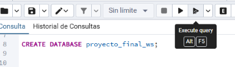
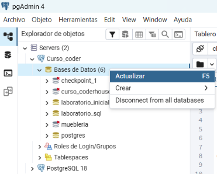
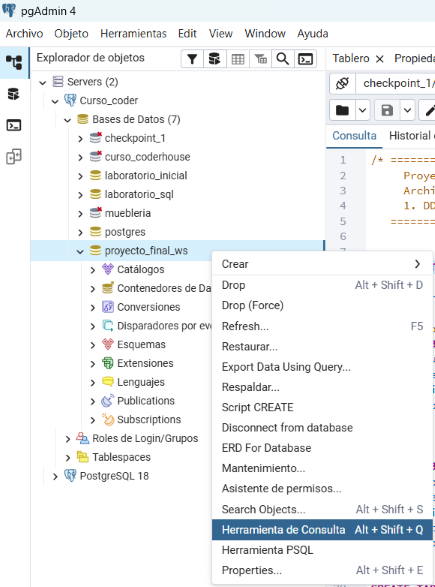
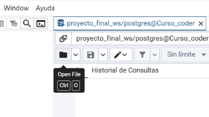
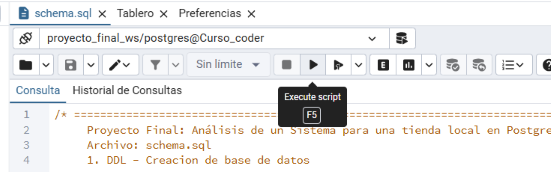
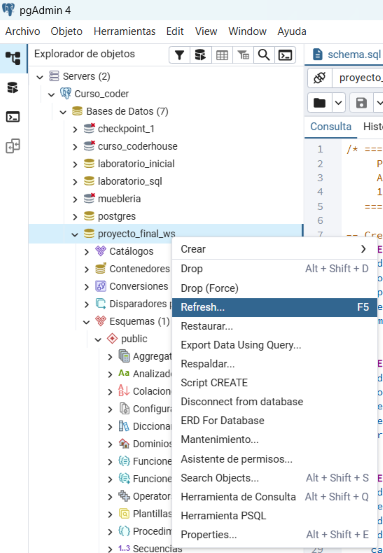

# Proyecto Final: Análisis de un Sistema para una tienda local en PostgreSQL.

Proyecto de creación, configuración, carga y análisis de una base de datos relacional de ventas respondiendo preguntas de negocio mediante SQL.

## Propósito de la base de datos y caso de uso.

Se trata de una pequeña empresa *ficticia* que vende y distribuye diferentes articulos de consumo a las personas, el periodo de ventas son de los años 2025 y 2026, los totales fiancieros se manejan como unidades monetarias.

Se require un análisis de la operación comercial para implementar mejoras, el objetivo es contestar las siguientes preguntas de negocio:

1. ¿Cuántos son los artículos de bebes que se venden y quien los ha comprado?
2. ¿Cuánto dinero ha gastado cada cliente?
3. ¿Cuántos pedidos por dia que se han hecho en el año 2026?
4. ¿Cuál es el rango de los artículos comparado contra el precio promedio?
5. ¿Cuáles son los tres productos mas vendidos?

## Cómo ejecutar el proyecto

Requisitos.
- PostgreSQL 12 o superior.
- pgAdmin 4.
- Usuario con permiso para crear bases de datos.

Pasos.
1. Conectarse a `postgreSQL`
2. Abrir una pestaña de consulta en `pgAdmin 4`
3. Escribir: **`CREATE DATABASE proyecto_final_ws;`** y dar click en el boton **Ejecutar query**  

4. Dar click derecho en **Base de Datos** y seleccionar **Actualizar** 

5. Seleccionar la recien creada base de datos, dar click derecho y seleccionar **Herramienta de Consulta** 

6. Abrir el archivo *schema.sql* 

 

7. Dar click en el boton **Ejecutar script** 

 

8. Dar click derecho en la base de datos creada **proyecto_final_ws** y seleccionar **Refresh...** para que se actualicen las tablas. 

9. Abrir el archivo *data.sql*

10. Dar click en el boton **Ejecutar script**

11. Abrir el archivo *queries.sql*

12. Ejecutar una a una las 5 consultas dando click en el boton **Ejecutar query**, leer los resultados generados de cada consulta del propósito de negocio.

> Cuidado. 👀  Si se vuelve a ejecutar el archivo *schema.sql* se modificará, eliminando y reconstruyendo las tablas dentro de la base de datos.
